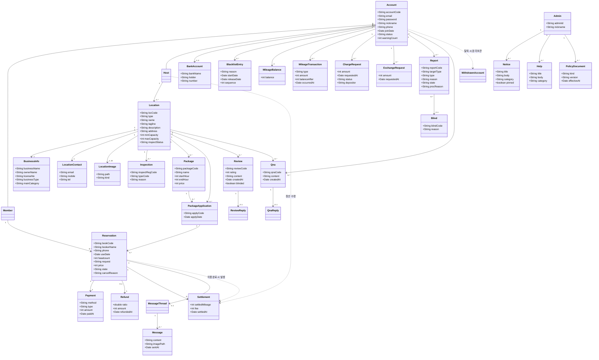

# 도메인 모델

> 문서 지도: [index](index.md) · [glossary](glossary.md) · [domain](domain.md) · [processes](processes.md) · [flows](flows.md) · [validation](validation.md) · [source](source/source.md) · [source.plain](source/source.plain.md)

## 모델 개요

- 액터는 관리자(`Admin`), 호스트(`Host`), 이용자(`Member`) 세 갈래이고, 호스트와 이용자는 같은 계정 테이블에서 역할로 갈린다. 관리자는 회원가입 경로가 없고 DB에 직접 입력한다 `[p.2]`.
- 거래 축은 `공간 → 패키지 → 패키지 적용 → 예약 → 결제(마일리지·에스크로) → 이용완료 → 정산`이다 `[p.16]`, `[p.18]`.
- 자금 축은 `마일리지 잔액 + 거래 이력`으로 분리하고, 충전·환전은 관리자 수동 승인 절차를 거친다 `[p.5]`.
- 게시물 축은 공간에 종속된 `리뷰`·`Q&A`(각 1개 답글)와, 공간과 분리된 `공지사항`·`도움말`이다 `[p.17]`, `[p.4]`.
- 제재 축은 `신고 → 신고 처리(인정/반려) → 경고 누적 → 블랙리스트`이고, 블라인드는 신고 처리와 별개로 게시물에 걸리는 노출 제어다 `[p.2]`, `[p.3]`.

## 회원

| 구성요소 | 이름 | 속성·책임 | 관계·불변식 | 출처 | 확실성 |
| --- | --- | --- | --- | --- | --- |
| 애그리거트 루트 | Account (회원) | 회원고유코드, 이메일(ID), 암호화된 비밀번호, 닉네임, 연락처, 가입일자, 상태(정상·블랙리스트·탈퇴), 경고 횟수 | 이메일은 전 역할에서 유일 `[p.12]`. 닉네임 중복 불가 `[p.12]`. 호스트·이용자 중 한 역할만 가진다 | `[p.12]`, `[p.13]` | 확정 |
| 엔티티 | Member (이용자) | 예약·리뷰·Q&A·마일리지의 소유자 | Account 1:1, 필수 | `[p.6]` | 확정 |
| 엔티티 | Host (호스트) | 공간·사업자 정보·정산·환전의 소유자 | Account 1:1, 필수. 예약 내역이 있으면 탈퇴 불가 | `[p.12]`, `[p.13]` | 확정 |
| 엔티티 | Admin (관리자) | admin_id, 비밀번호, 닉네임("관리자" 고정), 메뉴 권한 | 회원과 별도 저장소. 회원가입 불가 | `[p.2]`, `[정책 §관리자 1-1]` | 확정 |
| 엔티티 | WithdrawnAccount (탈퇴회원) | 탈퇴 시점의 식별 정보 스냅샷, 분리 보관 | Account 0..1. 탈퇴 시 닉네임·이메일·연락처·계좌·사업자 정보는 즉시 삭제되고 글은 비노출 | `[p.13]` | 모호 — 별도 테이블 언급만 있고 속성 정의가 없다 |
| 엔티티 | BlacklistEntry (블랙리스트 이력) | 지정 사유, 지정일, 해제 예정일, 누적 차수 | Account 1:N. 이력 차수에 따라 기간이 늘어난다(정책) | `[p.20]`, `[정책 §관리자 3-2]` | 충돌 — 영구 `[p.13]` vs 기간제 |
| 값 객체 | Email | 이메일 형식 `xxxx@xxx.xx`, 로그인 ID | 수정 불가 `[p.6]`, `[p.13]` | `[p.12]`, `[정책 §이용자 1-1]` | 확정 |
| 값 객체 | Password | 8~12자, 영문 대소문자 + 특수문자(!,@,#,$) 포함, 암호화 저장 | 평문 저장 금지 `[p.6]` | `[p.12]`, `[p.6]` | 확정 |
| 값 객체 | Nickname | 2~6자, 공백·특수문자 불가, 중복 불가 | 수정 가능 여부가 상충(호스트 불가 `[p.12]` vs 변경 가능 `[정책 §이용자 2-1]`) | `[p.12]`, `[정책 §이용자 1-1]` | 충돌 |

## 계정·계좌

| 구성요소 | 이름 | 속성·책임 | 관계·불변식 | 출처 | 확실성 |
| --- | --- | --- | --- | --- | --- |
| 엔티티 | BankAccount (계좌정보) | 은행명, 예금주, 계좌번호 | Account 1:N, 최대 3개 `[p.13]`. 계좌가 없으면 환전 신청 불가 `[p.19]` | `[p.13]` | 확정 |
| 값 객체 | AccountNumber | 숫자와 하이픈, 입력 시 하이픈 제외 | `[정책 §이용자 2-1]` | `[p.13]`, `[정책 §이용자 2-1]` | 확정 |
| 엔티티 | Session | 로그인 상태, 역할 구분자(`identify`), 회원코드 | 30분 무요청 시 자동 만료(정책) | `[기술 p.2]`, `[정책 §이용자 1-3]` | 모호 — 요구 PDF에 만료 규칙 없음 |

## 공간

| 구성요소 | 이름 | 속성·책임 | 관계·불변식 | 출처 | 확실성 |
| --- | --- | --- | --- | --- | --- |
| 애그리거트 루트 | Location (공간) | `loc_code`, 공간유형, 공간명, 한 줄 소개, 공간 소개, 시설 안내, 주의사항, 주소, 상세주소, 최소·최대 수용인원, 웹사이트, 이용시간, 정기·지정 휴무, 검수 상태 | Host 1:N. 검수 승인 전에는 검색·상세에 노출되지 않는다 `[p.3]`. 패키지가 없으면 검색에 노출되지 않는다 `[p.16]` | `[p.14]`, `[p.15]` | 확정 |
| 엔티티 | BusinessInfo (사업자 정보) | 상호명(개인/법인), 대표자명, 사업자등록번호, 사업자등록증, 사업자 유형, 주업태, 주종목, 사업장 주소 | Location 1:1 필수. 등록 후 전 항목 수정 불가 `[p.15]` | `[p.14]`, `[p.15]` | 확정 |
| 엔티티 | LocationContact (공간 연락처) | 이메일, 휴대폰, 대표 전화 | Location 1:1. 호스트 개인 연락처와 별개 `[p.14]` | `[p.14]` | 확정 |
| 엔티티 | LocationImage (공간 이미지) | 파일 경로, 구분(대표/상세), 순서 | Location 1:N. 대표 1장, 상세 1~10장. DB에는 경로만 저장 `[p.19]` | `[p.14]`, `[p.19]` | 확정 |
| 엔티티 | Inspection (검수) | `inspect_reg_code`, 처리 유형 코드, 반려 사유, 신청·처리일 | Location 1:N(이력). 검수 대기 중 공간 수정·삭제 불가 `[p.3]` | `[p.14]`, `[기술 p.57]`, `[기술 p.58]` | 확정 |
| 값 객체 | Capacity | 최소 1명 이상, 최대 30명, 최소 ≤ 최대 | `[p.14]`, `[정책 §호스트 3-1-2]` | `[p.14]` | 확정 |
| 값 객체 | Address | 도·시·구·동 + 상세주소. 우편번호 API로 입력 | 검수 후 주소·상세주소 수정 불가 `[p.15]` | `[p.14]`, `[정책 §이용자 3-1]` | 확정 |
| 값 객체 | RefundPolicy | 7일 전 100%, 6~1일 전 50%, 당일 환불 불가 | 공간 등록 화면에 명시 `[p.14]` | `[p.14]` | 확정 |

## 패키지

| 구성요소 | 이름 | 속성·책임 | 관계·불변식 | 출처 | 확실성 |
| --- | --- | --- | --- | --- | --- |
| 엔티티 | Package (패키지) | `packageCode`, 패키지명, 시작시간, 종료시간, 가격(부가세 포함) | Location 1:N. 이용시간 3시간 이상 34시간 이하 `[p.16]`, 가격 1,000~1,000,000원 `[p.16]` | `[p.16]` | 확정 |
| 엔티티 | PackageApplication (패키지 적용) | `applyCode`, 적용 날짜, 대상 패키지 | Location 1:N. 같은 날짜에 겹치지 않으면 여러 건 적용 가능 `[p.16]`. 적용 없는 날짜는 휴무 `[p.16]` | `[p.16]`, `[기술 p.47]` | 확정 |
| 값 객체 | TimeRange | 시작~종료. 종료는 익일 10시까지(최대 34시간) | `[p.16]`, `[정책 §호스트 3-1-3]` | `[p.16]` | 확정 |

## 예약·결제·정산

| 구성요소 | 이름 | 속성·책임 | 관계·불변식 | 출처 | 확실성 |
| --- | --- | --- | --- | --- | --- |
| 애그리거트 루트 | Reservation (예약) | `book_code`, 예약자명, 연락처, 이용일자·시간, 인원수, 요청사항, 결제금액, 예약 상태, 취소사유, 신청일시 | Member 1:N, PackageApplication 1:1. 이용일자는 오늘부터 3개월 이내 `[p.9]` | `[p.9]`, `[p.17]` | 확정 |
| 엔티티 | Payment (결제) | 결제수단(마일리지), 결제방식(바로결제·에스크로), 결제일시, 금액 | Reservation 1:1. 결제 성공 시 예약완료로 전이 `[p.9]` | `[p.9]`, `[p.16]` | 확정 |
| 엔티티 | Refund (환불) | 환불 비율, 환불 금액, 환불일자, 취소 주체 | Reservation 0..1. 비율은 취소 시점과 주체에 따라 달라진다 | `[p.18]` | 모호 — 산식이 해석 불가 |
| 엔티티 | Settlement (정산) | 정산 마일리지, 수수료, 정산일자, 취소일 | Reservation 1:1. 이용완료 후 발생 | `[p.19]` | 충돌 — 자동/수동 |
| 값 객체 | Money | 원 단위 정수, 부가세 포함 표기 | 1,000~1,000,000원 범위는 패키지 가격에만 명시 `[p.16]` | `[p.16]` | 확정 |
| 값 객체 | ReservationState | 예약완료 / 이용완료 / 취소(환불) | 값 집합이 문서마다 다르다 → [V-STATUS-RESERVATION-01](validation.md#v-status-reservation-01) | `[p.9]`, `[p.17]` | 충돌 |

## 마일리지

| 구성요소 | 이름 | 속성·책임 | 관계·불변식 | 출처 | 확실성 |
| --- | --- | --- | --- | --- | --- |
| 엔티티 | MileageBalance (잔액) | 현재 보유 마일리지 | Account 1:1. 잔액이 0이 아니면 탈퇴 불가 `[p.10]` | `[p.7]`, `[p.10]` | 확정 |
| 엔티티 | MileageTransaction (거래) | 구분(충전·사용·환전·환불), 금액, 잔액, 발생일시, 참조 예약 | Account 1:N. 이용자 화면은 네 종류를 한 목록에서 보여준다 `[p.7]` | `[p.7]` | 확정 |
| 엔티티 | ChargeRequest (충전 신청) | 신청 금액, 신청일시, 처리 상태, 입금 계좌·예금주, 관리자 처리일 | Account 1:N. 동시에 1건만 존재 가능 `[p.10]`. 대기 시간 초과 또는 금액 불일치 시 실패 `[p.5]` | `[p.5]`, `[p.10]` | 모호 — 대기 시간 값 없음 |
| 엔티티 | ExchangeRequest (환전 신청) | 환전 금액, 수령 계좌, 신청일자 | Account 1:N. 최소 1,000원(정책). 관리자가 입금 후 완료 처리 `[p.5]`. 완료 건만 남겨 상태를 관리하지 않는다 `[p.19]` | `[p.5]`, `[p.19]` | 충돌 — 상태 관리 여부 |
| 도메인 서비스 | SettlementService | 이용완료 전이 시 수수료를 차감해 호스트 잔액으로 이체 | 정산 시점·주체가 상충 → [V-PROC-SETTLE-01](validation.md#v-proc-settle-01) | `[p.18]`, `[p.19]` | 모호 |

## 게시물

| 구성요소 | 이름 | 속성·책임 | 관계·불변식 | 출처 | 확실성 |
| --- | --- | --- | --- | --- | --- |
| 엔티티 | Review (리뷰) | `review_code`, 별점(1~5), 내용, 사진(복수), 작성일, 블라인드 여부 | Location 1:N, Member 1:N. 호스트 답글 1개 `[p.17]`. 삭제 시에도 행은 남기고 비노출 `[정책 §이용자 4-3]` | `[p.8]`, `[p.17]` | 확정 |
| 엔티티 | ReviewReply (리뷰 답글) | 내용, 작성일 | Review 1:0..1. 원글 삭제와 무관하게 유지 `[정책 §이용자 4-3]` | `[p.17]` | 확정 |
| 엔티티 | Qna (공간 Q&A) | `qna_code`, 문의 내용, 작성일 | Location 1:N, Member 1:N. 답글 1개 `[p.17]` | `[p.8]`, `[p.17]` | 확정 |
| 엔티티 | QnaReply (Q&A 답글) | 내용, 작성일 | Qna 1:0..1 | `[p.17]` | 확정 |
| 엔티티 | Notice (공지사항) | 제목, 내용, 유형(기능·정책·긴급·사과), 첨부·이미지, 상단 고정, 작성·수정일 | Admin 1:N. 고정 글은 1페이지 상단에 날짜순으로 노출 `[p.4]` | `[p.4]` | 확정 |
| 엔티티 | Help (도움말) | 제목, 내용, 카테고리, 이미지, 작성일 | Admin 1:N. 카테고리로 검색 `[p.4]` | `[p.4]` | 확정 |
| 엔티티 | PolicyDocument (약관·정책 문서) | 종류(이용약관·개인정보처리방침·정산환불·공간관리), 버전, 시행일 | 이전 버전도 조회 가능 `[p.11]` | `[p.11]` | 확정 |

## 신고·제재

| 구성요소 | 이름 | 속성·책임 | 관계·불변식 | 출처 | 확실성 |
| --- | --- | --- | --- | --- | --- |
| 엔티티 | Report (신고) | `loc_report_code`/`book_report_code`, 대상 유형, 신고 유형, 사유, 첨부 이미지, 신고자, 접수일시, 처리 상태(인정·반려), 처리 사유 | Account 1:N. 게시물 1건에 여러 신고가 붙고, 게시물 단위로 일괄 처리된다 `[정책 §관리자 2-1]` | `[p.2]`, `[p.20]`, `[기술 p.9]` | 확정 |
| 엔티티 | Blind (블라인드) | `loc_blind_code`, 대상, 사유, 처리일, 해제일 | Location/Review/Qna 0..1. 관리자 해제 가능 `[p.2]`. 해제 시 재노출 | `[p.2]`, `[기술 p.4]` | 확정 |
| 엔티티 | Warning (경고) | 누적 횟수, 사유, 발생 신고 | Account 1:N. 3회 누적 시 블랙리스트 전환(정책) | `[p.11]`, `[정책 §이용자 10]` | 모호 — 요구 PDF에 임계값 없음 |
| 값 객체 | ReportType | 공간 신고(이용자→호스트), 예약 신고(호스트→이용자), 메시지 신고 | `[p.20]`, `[정책 §호스트 7-1]` | `[p.20]` | 확정 |
| 정책 | Penalty (제재) | 블랙리스트 기간, 예약·리뷰·Q&A 제한, 마일리지 자동환불 | 위반 시 서비스 이용 제한 | `[p.3]`, `[p.20]` | 충돌 |

## 콘텐츠·메시지

| 구성요소 | 이름 | 속성·책임 | 관계·불변식 | 출처 | 확실성 |
| --- | --- | --- | --- | --- | --- |
| 엔티티 | MessageThread (대화방) | 예약 1건당 1개, 참여자(이용자·호스트), 마지막 메시지 시각 | Reservation 1:0..1. 호스트 탈퇴 시 대화 비노출 `[정책 §이용자 6]` | `[p.10]`, `[p.19]` | 확정 |
| 엔티티 | Message (메시지) | 내용, 첨부 이미지 경로, 발송 시각, 발신자 | Thread 1:N. 이용완료 이후 전송 불가 `[p.18]` | `[p.19]` | 확정 |
| 외부 시스템 | MailSender | 인증 메일, 비밀번호 재설정, 검수 결과, 신고 처리 결과 발송 | 단일 책임. 실패·재시도 규칙 없음 → [V-INT-EMAIL-01](validation.md#v-int-email-01) | `[p.2]`, `[p.15]`, `[기술 p.24]` | 확정 |
| 외부 시스템 | AddressApi (우편번호) | 주소 검색·우편번호 반환 | `[정책 §이용자 3-1]` | `[p.7]`, `[정책 §이용자 3-1]` | 확정 |
| 외부 시스템 | MapApi (카카오맵) | 검색 결과 지도 표시, 핀·클러스터 | `[정책 §이용자 3-6]` | `[p.8]`, `[정책 §이용자 3-6]` | 모호 — 반경·클러스터 규칙이 요구 PDF에 없음 |

## 클래스 다이어그램

실선은 원문에 근거가 있는 관계, 점선은 추론한 관계다. 카디널리티는 `1 -- 0..*` 형태로 적었다.

## 상태 전이

### Account 상태

| 현재 | 다음 | 전이 조건 | 출처 | 관련 |
| --- | --- | --- | --- | --- |
| 정상 | 블랙리스트 | 관리자가 신고를 인정하고 제재를 결정. 정책 문서는 경고 3회 누적을 기준으로 한다 | `[p.3]`, `[정책 §이용자 10]` | [P-ACCOUNT-BLACKLIST-01](processes.md#p-account-blacklist-01), [V-ACCOUNT-BLACKLIST-01](validation.md#v-account-blacklist-01) |
| 블랙리스트 | 정상 | 관리자가 문의·심사 후 복구. 복구 즉시 모든 기능 사용 가능 | `[p.3]` | [P-ACCOUNT-BLACKLIST-01](processes.md#p-account-blacklist-01) |
| 정상 | 탈퇴 | 비밀번호 재확인 + 잔여 마일리지 0. 예약 보유 여부는 문서가 갈린다 | `[p.10]`, `[p.13]` | [P-ACCOUNT-WITHDRAW-01](processes.md#p-account-withdraw-01), [V-ACCOUNT-WITHDRAW-01](validation.md#v-account-withdraw-01) |

### Location 검수 상태

| 현재 | 다음 | 전이 조건 | 출처 | 관련 |
| --- | --- | --- | --- | --- |
| 작성중 | 검수 대기 | 호스트가 필수 정보를 모두 입력하고 검수 신청 | `[p.14]` | [P-PROC-INSPECT-01](processes.md#p-proc-inspect-01) |
| 검수 대기 | 검수 승인(게시) | 관리자가 적법·필수 정보 충족으로 판단 | `[p.4]`, `[p.14]` | [P-PROC-INSPECT-01](processes.md#p-proc-inspect-01) |
| 검수 대기 | 검수 반려 | 관리자가 부적합으로 판단. 반려 사유 입력 | `[p.4]`, `[기술 p.58]` | [V-STATUS-INSPECT-02](validation.md#v-status-inspect-02) |
| 검수 반려 | 삭제 | 재신청 불가, 삭제만 허용(요구 PDF). 정책 문서는 재신청 허용 | `[p.15]`, `[정책 §호스트 3-2]` | [V-STATUS-INSPECT-02](validation.md#v-status-inspect-02) |
| 검수 승인 | 검수 대기 | 승인 후 정보를 수정하면 재검수 없이 유지(요구 PDF) | `[p.15]` | [P-DOMAIN-SPACE-MANAGE-01](processes.md#p-domain-space-manage-01) |
| 검수 승인·반려 | 삭제 | 이후 예약이 없을 때만 가능. 검수 대기 중에는 삭제 불가 | `[p.15]`, `[p.3]` | [P-DOMAIN-SPACE-MANAGE-01](processes.md#p-domain-space-manage-01) |

### Reservation 상태

| 현재 | 다음 | 전이 조건 | 출처 | 관련 |
| --- | --- | --- | --- | --- |
| (없음) | 예약완료 | 마일리지 결제 성공. 동시 예약은 결제 성공이 빠른 쪽이 선점 | `[p.9]` | [P-DOMAIN-RESERVATION-01](processes.md#p-domain-reservation-01) |
| 예약완료 | 이용완료 | 체크아웃 시각 경과(판정 주체·배치 미정의) | `[p.17]` | [V-STATUS-RESERVATION-01](validation.md#v-status-reservation-01) |
| 예약완료 | 예약취소(환불완료) | 이용 전날 23:59까지 이용자 취소 + 환불 정책 적용 | `[p.9]`, `[p.18]` | [P-DOMAIN-RESERVATION-CANCEL-01](processes.md#p-domain-reservation-cancel-01) |
| 예약완료 | 환불신청 → 환불완료 | 정책 문서의 2단계 모델. 요구 PDF에는 없는 상태 | `[정책 §이용자 5-3]` | [V-STATUS-RESERVATION-01](validation.md#v-status-reservation-01) |

### ChargeRequest 상태

| 현재 | 다음 | 전이 조건 | 출처 | 관련 |
| --- | --- | --- | --- | --- |
| (없음) | 대기 | 이용자가 금액을 입력해 충전 신청. 동시에 1건만 가능 | `[p.5]`, `[p.10]` | [P-DOMAIN-MILEAGE-CHARGE-01](processes.md#p-domain-mileage-charge-01) |
| 대기 | 완료 | 관리자가 예금주·금액을 확인하고 승인 → 마일리지 증가 | `[p.5]` | [P-DOMAIN-MILEAGE-CHARGE-01](processes.md#p-domain-mileage-charge-01) |
| 대기 | 실패 | 대기 시간 초과 또는 입금액 불일치 | `[p.5]`, `[p.10]` | [V-DOMAIN-MILEAGE-CHARGE-01](validation.md#v-domain-mileage-charge-01) |

### ExchangeRequest 상태

| 현재 | 다음 | 전이 조건 | 출처 | 관련 |
| --- | --- | --- | --- | --- |
| (없음) | 신청 | 이용자·호스트가 금액과 계좌를 지정해 신청. 계좌 없으면 등록 페이지로 이동 | `[p.19]` | [P-DOMAIN-MILEAGE-EXCHANGE-01](processes.md#p-domain-mileage-exchange-01) |
| 신청 | 완료 | 관리자가 계좌 입금 후 완료 처리. 완료 건만이력으로 남는다 | `[p.5]`, `[p.19]` | [V-STATUS-MILEAGE-01](validation.md#v-status-mileage-01) |

### Report 상태

| 현재 | 다음 | 전이 조건 | 출처 | 관련 |
| --- | --- | --- | --- | --- |
| 접수 | 인정 | 관리자가 운영정책 위반으로 판단. 사유 입력 후 신고자·피신고자에게 메일 발송 | `[p.2]`, `[정책 §관리자 2-1]` | [P-PROC-REPORT-01](processes.md#p-proc-report-01) |
| 접수 | 반려 | 위반이 아니라고 판단 | `[p.2]` | [P-PROC-REPORT-01](processes.md#p-proc-report-01) |

### 게시물 노출 상태

| 현재 | 다음 | 전이 조건 | 출처 | 관련 |
| --- | --- | --- | --- | --- |
| 게시 | 블라인드 | 신고 누적 3건(정책) 또는 관리자 처리, 작성자 탈퇴·블랙리스트 | `[p.2]`, `[정책 §이용자 4-3]` | [P-DOMAIN-REVIEW-01](processes.md#p-domain-review-01) |
| 블라인드 | 게시 | 관리자가 블라인드 해제 | `[p.2]` | [P-PROC-REPORT-01](processes.md#p-proc-report-01) |

## 불변식

| 번호 | 불변식 | 출처 | 관련 |
| --- | --- | --- | --- |
| 1 | 이메일은 로그인 ID이며 호스트·이용자·관리자 전체에서 중복될 수 없다 | `[p.12]` | [V-ACCOUNT-SIGNUP-01](validation.md#v-account-signup-01) |
| 2 | 비밀번호는 8~12자, 영문 대소문자와 특수문자(!,@,#,$)를 포함하고 암호화해 저장한다 | `[p.6]`, `[p.12]` | [V-SEC-PRIVACY-01](validation.md#v-sec-privacy-01) |
| 3 | 계좌정보는 회원당 최대 3개이며, 계좌가 없으면 환전 신청을 받을 수 없다 | `[p.13]`, `[p.19]` | [P-DOMAIN-MILEAGE-EXCHANGE-01](processes.md#p-domain-mileage-exchange-01) |
| 4 | 잔여 마일리지가 0이 아니면 회원 탈퇴를 진행할 수 없다 | `[p.10]`, `[p.13]` | [P-ACCOUNT-WITHDRAW-01](processes.md#p-account-withdraw-01) |
| 5 | 예약은 신청일 기준 3개월 이내 날짜만 가능하다 | `[p.9]` | [P-DOMAIN-RESERVATION-01](processes.md#p-domain-reservation-01) |
| 6 | 이용자 취소는 이용 전날 23:59까지 가능하고 당일 취소는 불가하다 | `[p.9]` | [V-DOMAIN-RESERVATION-01](validation.md#v-domain-reservation-01) |
| 7 | 패키지 이용시간은 3시간 이상 34시간 이하, 가격은 부가세 포함 1,000~1,000,000원이다 | `[p.16]` | [P-DOMAIN-PACKAGE-01](processes.md#p-domain-package-01) |
| 8 | 패키지가 적용되지 않은 날짜는 휴무이며 예약할 수 없다 | `[p.16]` | [P-DOMAIN-PACKAGE-01](processes.md#p-domain-package-01) |
| 9 | 검수 승인 전 공간은 검색·상세에 노출되지 않는다. 검수 대기 중에는 수정·삭제할 수 없다 | `[p.3]`, `[p.4]` | [P-PROC-INSPECT-01](processes.md#p-proc-inspect-01) |
| 10 | 이후 예약이 남아 있으면 공간을 삭제할 수 없다 | `[p.15]` | [V-DOMAIN-SPACE-01](validation.md#v-domain-space-01) |
| 11 | 결제는 마일리지로만 하고 에스크로 방식으로 보관한다 | `[p.16]`, `[p.19]` | [V-INT-PAYMENT-01](validation.md#v-int-payment-01) |
| 12 | 충전 신청은 이전 신청의 처리가 끝난 뒤에만 가능하다 | `[p.10]` | [P-DOMAIN-MILEAGE-CHARGE-01](processes.md#p-domain-mileage-charge-01) |
| 13 | 블랙리스트·탈퇴 회원이 쓴 글은 내용은 남기고 닉네임을 "알 수 없는 회원"으로 표시한다 | `[p.8]`, `[p.11]` | [P-ACCOUNT-BLACKLIST-01](processes.md#p-account-blacklist-01) |
| 14 | 같은 패키지 날짜에는 결제가 성공한 예약 1건만 존재한다 | `[p.9]` | [V-DOMAIN-RESERVATION-02](validation.md#v-domain-reservation-02) |

## 용어-도메인 매핑

| 용어 사전 | 도메인 모델 | 비고 |
| --- | --- | --- |
| 회원고유코드 | `Account.accountCode` | 기술문서는 역할별로 `member_code`/`host_code`를 쓴다 `[기술 p.31]` |
| 검수 | `Inspection` | 검수 신청 코드와 처리 유형 코드가 별도다 `[기술 p.57]` |
| 블라인드 | `Blind` | 공간·리뷰·Q&A에 걸린다 `[기술 p.4]` |
| 신고 | `Report` | 공간 신고/예약 신고 코드가 분리된다 `[기술 p.9]` |
| PIRI | `MessageThread` + `Message` | 예약 1건당 대화방 1개로 추론했다 |
| 공지사항·도움말 | `Notice` / `Help` | 둘 다 관리자 작성 콘텐츠지만 고정·카테고리 규칙이 다르다 |
