# 플로우차트

> 문서 지도: [index](index.md) · [glossary](glossary.md) · [domain](domain.md) · [processes](processes.md) · [flows](flows.md) · [validation](validation.md) · [source](source/source.md) · [source.plain](source/source.plain.md)

## 읽는 법

- 각 플로우는 같은 ID의 프로세스와 1:1 대응한다([processes.md](processes.md)).
- 노드 ID는 `{TOPIC}{NN}_{NODE}` 규칙을 따르고 `START`·`END`는 예약어다.
- 원문에 없는 분기는 도표 아래에 `추론`으로 표시했다. 렌더링 도구(mmdc)가 없어 Mermaid 소스로만 보관한다.

## F-AUTH-LOGIN-01

**로그인·로그아웃·세션 유지**

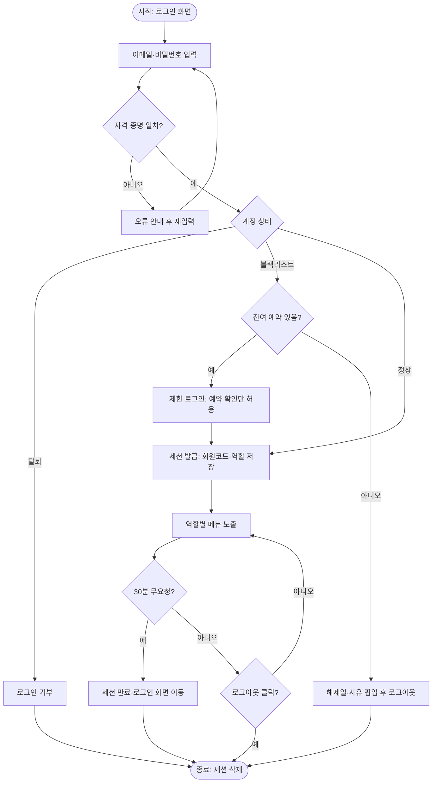

- 대응 프로세스: [P-AUTH-LOGIN-01](processes.md#p-auth-login-01)
- 관련 finding: [V-AUTH-BLACKLIST-01](validation.md#v-auth-blacklist-01), [V-AUTH-SESSION-01](validation.md#v-auth-session-01)
- 추론: 블랙리스트 로그인을 "거부"와 "제한 허용"으로 나눈 분기. 원문은 두 규칙을 함께 적어 판단이 갈린다.

## F-AUTH-PASSWORD-RESET-01

**비밀번호 찾기·재설정**

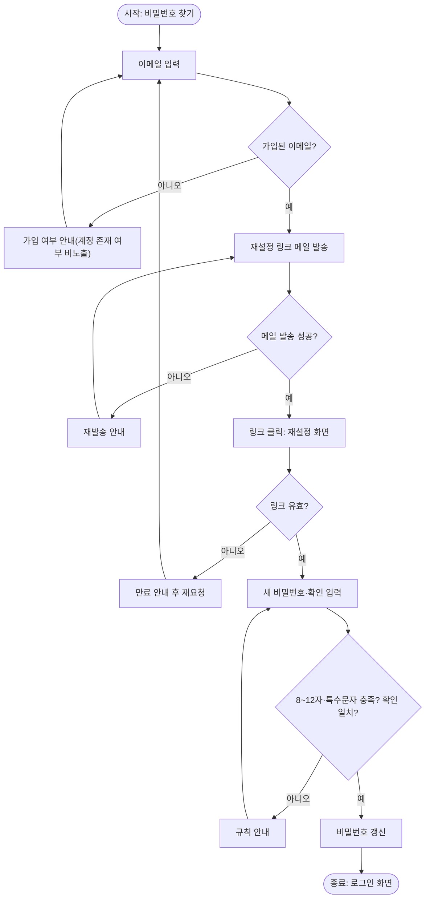

- 대응 프로세스: [P-AUTH-PASSWORD-RESET-01](processes.md#p-auth-password-reset-01)
- 관련 finding: [V-SEC-PRIVACY-01](validation.md#v-sec-privacy-01)
- 추론: 링크 만료 시간과 기존 세션 무효화 규칙은 원문에 없어 일반 관행으로 분기를 두었다.

## F-ACCOUNT-SIGNUP-01

**회원가입·이메일 인증**

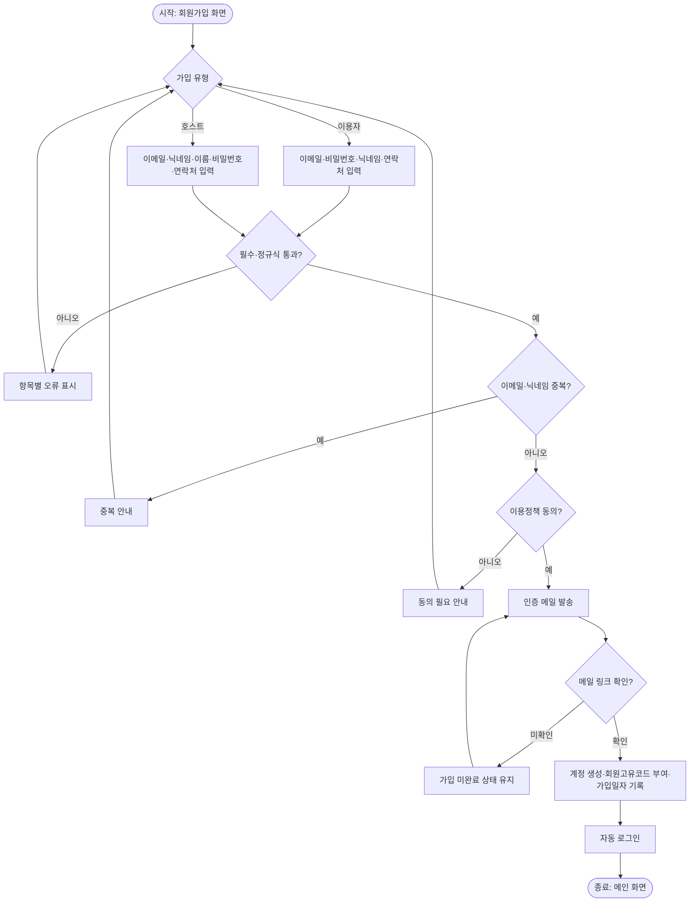

- 대응 프로세스: [P-ACCOUNT-SIGNUP-01](processes.md#p-account-signup-01)
- 관련 finding: [V-ACCOUNT-SIGNUP-01](validation.md#v-account-signup-01)
- 추론: 이용자 가입에 이름 항목이 없고 호스트 가입에만 있는 것은 원문 그대로다. 두 양식을 한 플로우에 합친 것은 추론이다.

## F-ACCOUNT-WITHDRAW-01

**회원 탈퇴·데이터 분리보관**

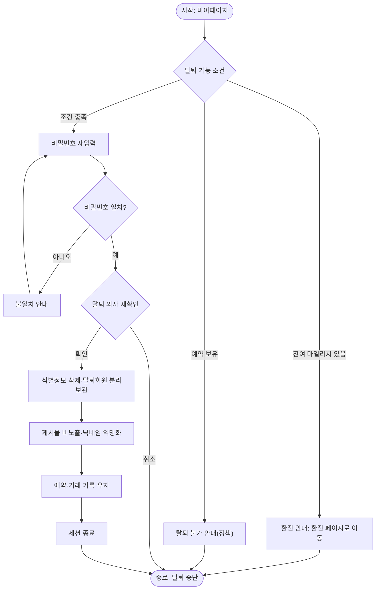

- 대응 프로세스: [P-ACCOUNT-WITHDRAW-01](processes.md#p-account-withdraw-01)
- 관련 finding: [V-ACCOUNT-WITHDRAW-01](validation.md#v-account-withdraw-01), [V-DATA-RETENTION-01](validation.md#v-data-retention-01)
- 추론: "예약 보유 시 탈퇴 불가"는 정책 문서 규칙이라 요구 PDF와 어긋난다. 플로우는 정책 쪽을 따랐다.

## F-ACCOUNT-BLACKLIST-01

**블랙리스트 지정·해제**

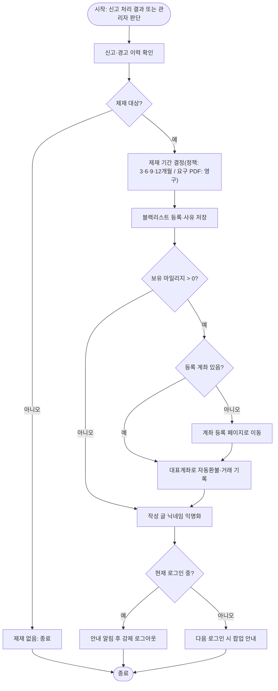

- 대응 프로세스: [P-ACCOUNT-BLACKLIST-01](processes.md#p-account-blacklist-01)
- 관련 finding: [V-ACCOUNT-BLACKLIST-01](validation.md#v-account-blacklist-01), [V-PERM-BLACKLIST-01](validation.md#v-perm-blacklist-01), [V-DOMAIN-MILEAGE-REFUND-01](validation.md#v-domain-mileage-refund-01)
- 추론: 잔여 예약이 있는 경우의 제한 로그인 분기는 로그인 플로우에 두었다.

## F-DOMAIN-SPACE-REGISTER-01

**공간 등록**

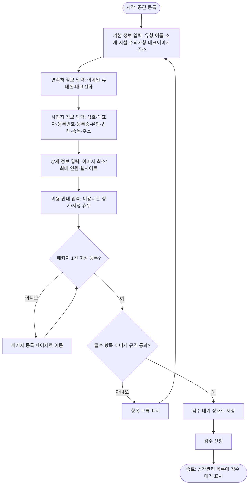

- 대응 프로세스: [P-DOMAIN-SPACE-REGISTER-01](processes.md#p-domain-space-register-01)
- 관련 finding: [V-DOMAIN-SPACE-02](validation.md#v-domain-space-02), [V-DOMAIN-PACKAGE-01](validation.md#v-domain-package-01)
- 추론: 패키지 등록을 공간 등록의 선행 조건으로 배치했다. 원문은 "패키지가 없으면 등록 불가 안내"만 서술한다 `[정책 §호스트 3-1]`.

## F-PROC-INSPECT-01

**검수 신청·승인·반려**

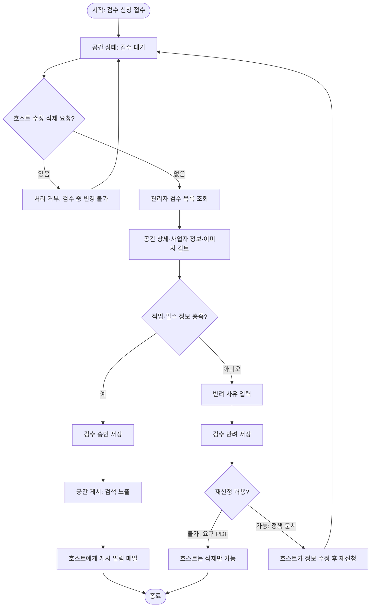

- 대응 프로세스: [P-PROC-INSPECT-01](processes.md#p-proc-inspect-01)
- 관련 finding: [V-STATUS-INSPECT-01](validation.md#v-status-inspect-01), [V-STATUS-INSPECT-02](validation.md#v-status-inspect-02)
- 추론: 없음. 재신청 분기는 문서 충돌을 그대로 두 갈래로 그린 것이다.

## F-DOMAIN-SPACE-MANAGE-01

**공간 조회·수정·삭제**

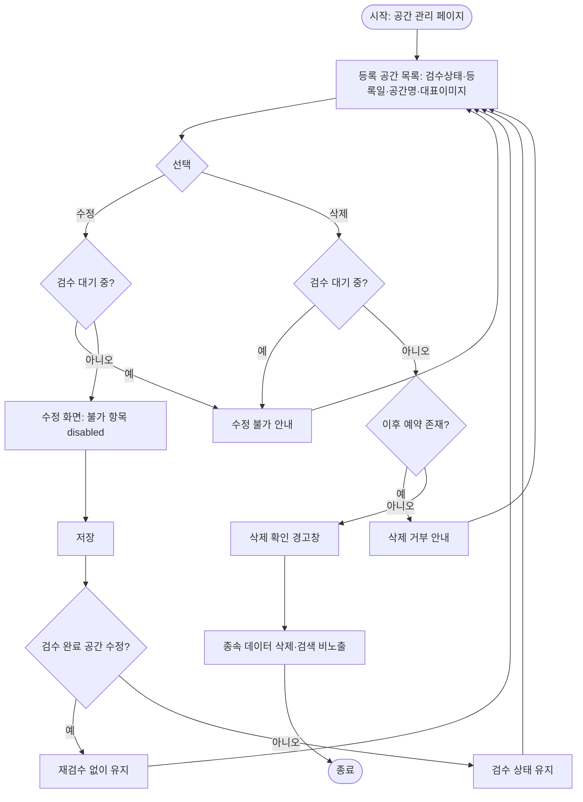

- 대응 프로세스: [P-DOMAIN-SPACE-MANAGE-01](processes.md#p-domain-space-manage-01)
- 관련 finding: [V-DOMAIN-SPACE-01](validation.md#v-domain-space-01)
- 추론: 삭제 시 리뷰·Q&A·예약을 함께 지우는지 여부는 문서가 갈린다. 플로우는 정책 문서의 연쇄 삭제를 따랐다.

## F-DOMAIN-PACKAGE-01

**패키지 등록·적용**

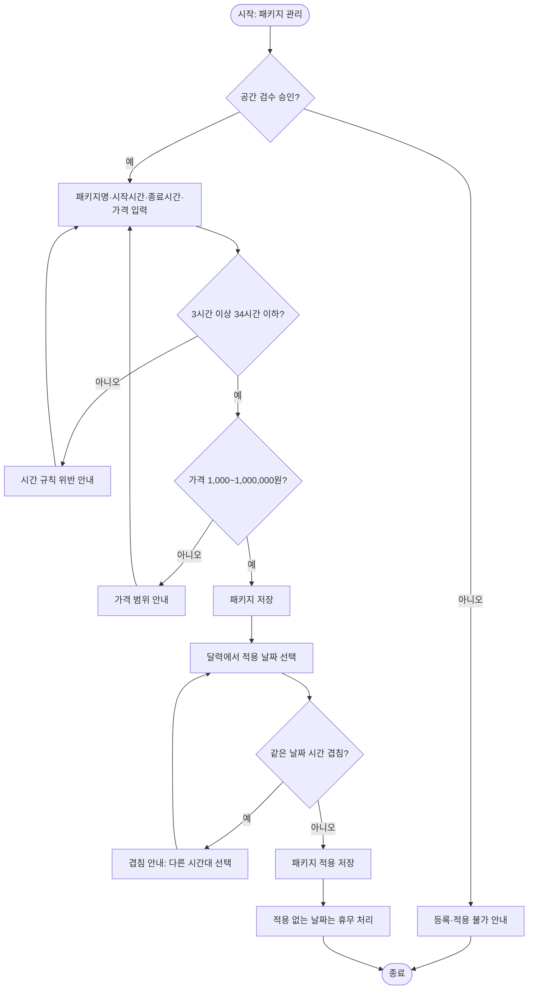

- 대응 프로세스: [P-DOMAIN-PACKAGE-01](processes.md#p-domain-package-01)
- 관련 finding: [V-DOMAIN-PACKAGE-01](validation.md#v-domain-package-01)
- 추론: 검수 승인 여부를 패키지 관리 진입 조건으로 배치했다. 원문은 "검수 승인된 공간만 패키지 등록·적용 가능"이라고만 적는다 `[p.16]`.

## F-DOMAIN-RESERVATION-01

**예약 생성·마일리지 결제**

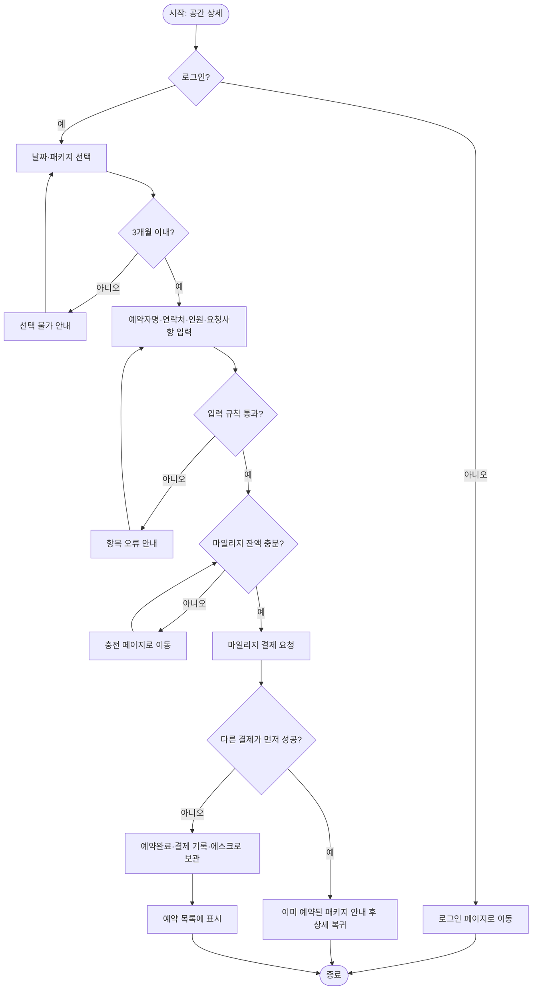

- 대응 프로세스: [P-DOMAIN-RESERVATION-01](processes.md#p-domain-reservation-01)
- 관련 finding: [V-DOMAIN-RESERVATION-02](validation.md#v-domain-reservation-02), [V-INT-PAYMENT-01](validation.md#v-int-payment-01)
- 추론: 패키지 날짜 잠금 시점을 결제 시점으로 그렸다. 원문은 "결제가 먼저 성공하는 사람이 우선"만 서술한다 `[p.9]`.

## F-DOMAIN-RESERVATION-CANCEL-01

**예약 취소·환불**

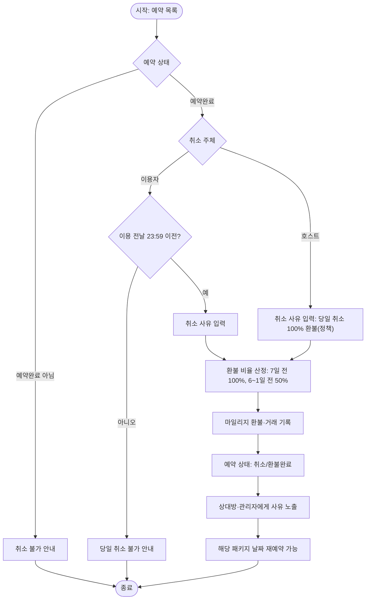

- 대응 프로세스: [P-DOMAIN-RESERVATION-CANCEL-01](processes.md#p-domain-reservation-cancel-01)
- 관련 finding: [V-DOMAIN-RESERVATION-01](validation.md#v-domain-reservation-01), [V-DOMAIN-PAYMENT-01](validation.md#v-domain-payment-01)
- 추론: 호스트 취소의 환불 비율은 정책 문서의 100% 규칙을 따랐다. 요구 PDF는 "호스트나 이용자가 취소"만 서술한다 `[p.17]`.

## F-DOMAIN-MILEAGE-CHARGE-01

**마일리지 충전 신청·승인**

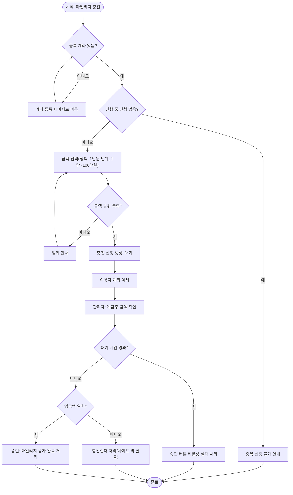

- 대응 프로세스: [P-DOMAIN-MILEAGE-CHARGE-01](processes.md#p-domain-mileage-charge-01)
- 관련 finding: [V-DOMAIN-MILEAGE-CHARGE-01](validation.md#v-domain-mileage-charge-01), [V-DOMAIN-MILEAGE-CHARGE-02](validation.md#v-domain-mileage-charge-02), [V-STATUS-MILEAGE-01](validation.md#v-status-mileage-01)
- 추론: 대기 시간 경과 판정을 관리자 화면에서 수행하는 것으로 그렸다. 배치 여부는 원문에 없다.

## F-DOMAIN-MILEAGE-EXCHANGE-01

**마일리지 환전**

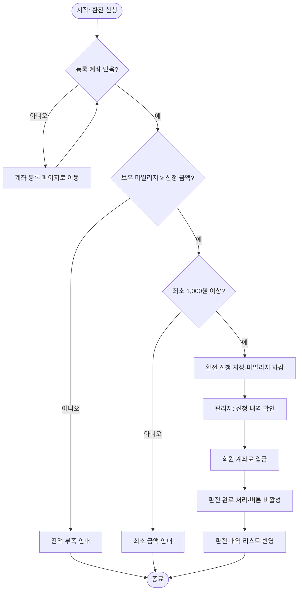

- 대응 프로세스: [P-DOMAIN-MILEAGE-EXCHANGE-01](processes.md#p-domain-mileage-exchange-01)
- 관련 finding: [V-STATUS-MILEAGE-01](validation.md#v-status-mileage-01), [V-DOMAIN-MILEAGE-REFUND-01](validation.md#v-domain-mileage-refund-01)
- 추론: 신청 시점의 마일리지 차감을 그렸다. 원문은 "환전과 동시에 입금·차감"과 "관리자 완료 처리"를 함께 적어 시점이 불명확하다 `[p.5]`.

## F-DOMAIN-MILEAGE-SETTLE-01

**정산**

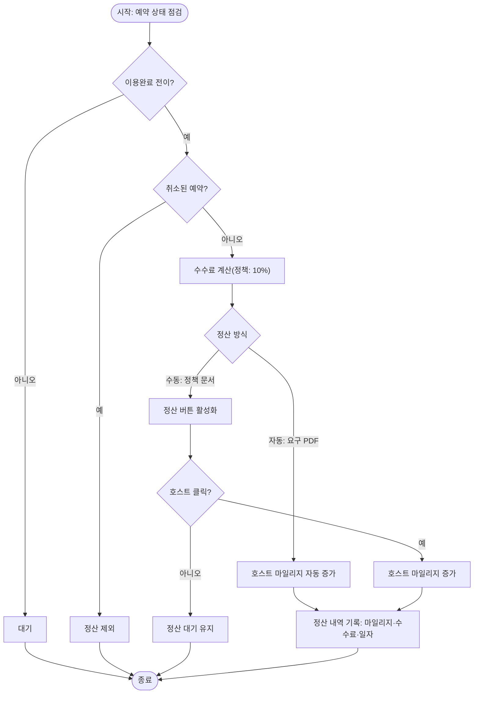

- 대응 프로세스: [P-DOMAIN-MILEAGE-SETTLE-01](processes.md#p-domain-mileage-settle-01)
- 관련 finding: [V-PROC-SETTLE-01](validation.md#v-proc-settle-01), [V-DOMAIN-MILEAGE-SETTLE-01](validation.md#v-domain-mileage-settle-01)
- 추론: 없음. 자동·수동 두 갈래는 문서 충돌을 그대로 반영한 것이다.

## F-DOMAIN-REVIEW-01

**리뷰 작성·답변·신고**

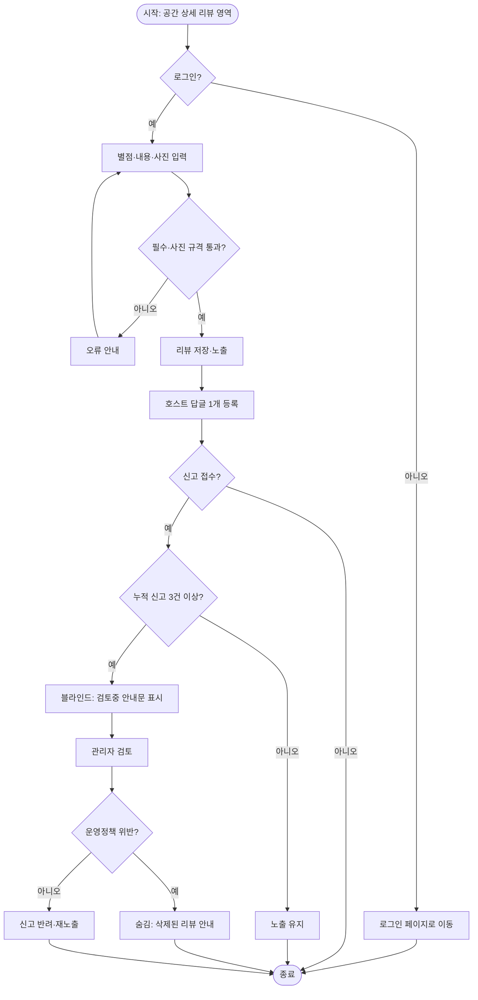

- 대응 프로세스: [P-DOMAIN-REVIEW-01](processes.md#p-domain-review-01)
- 관련 finding: [V-DOMAIN-REVIEW-01](validation.md#v-domain-review-01), [V-DOMAIN-REVIEW-02](validation.md#v-domain-review-02)
- 추론: 작성 자격 검사를 "로그인"만으로 두었다. 이용완료 여부를 요구 PDF가 명시하지 않는다.

## F-DOMAIN-QNA-01

**Q&A 작성·답변**

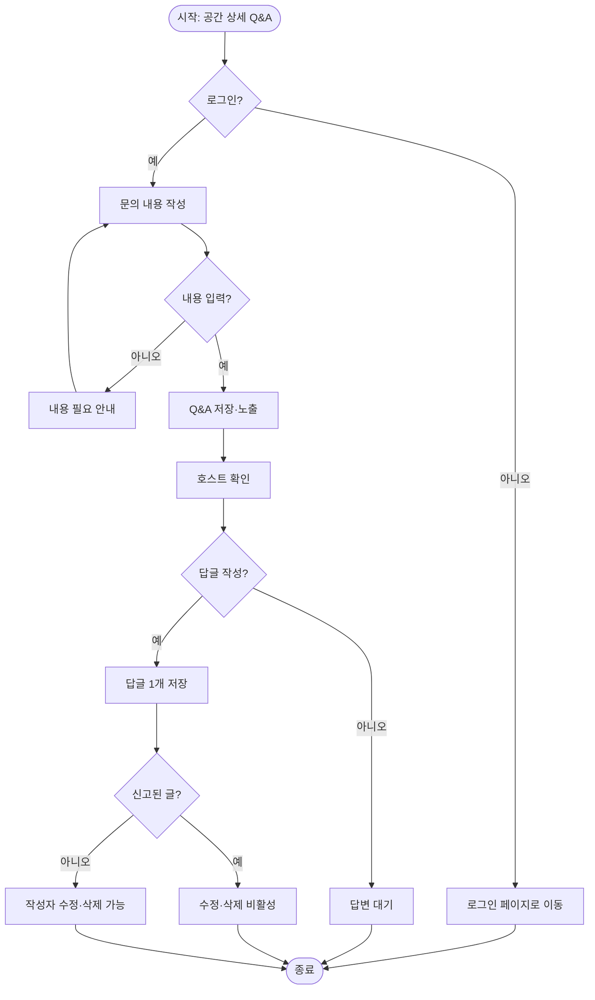

- 대응 프로세스: [P-DOMAIN-QNA-01](processes.md#p-domain-qna-01)
- 관련 finding: [V-DOMAIN-QNA-01](validation.md#v-domain-qna-01)
- 추론: 신고된 글의 수정·삭제 차단은 정책 문서 규칙만 있다 `[정책 §이용자 4-3]`.

## F-PROC-REPORT-01

**신고 접수·처리**

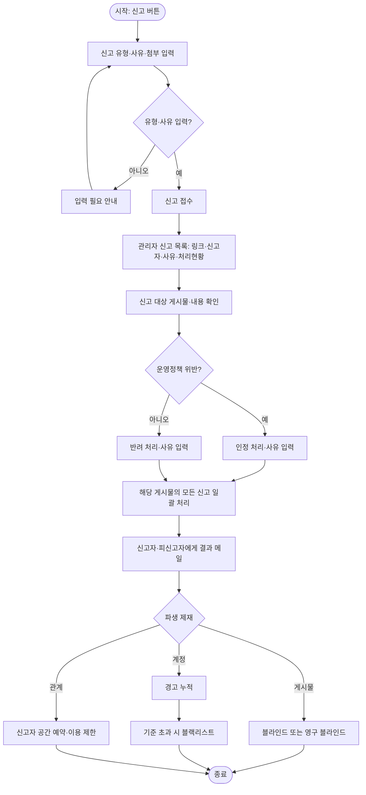

- 대응 프로세스: [P-PROC-REPORT-01](processes.md#p-proc-report-01)
- 관련 finding: [V-PROC-REPORT-01](validation.md#v-proc-report-01)
- 추론: 경고 누적과 블랙리스트 전환을 신고 처리의 파생 단계로 배치했다. 요구 PDF는 관리자 주관 판단만 서술한다 `[p.3]`.

## F-DOMAIN-MESSAGE-01

**PIRI 1:1 문의**

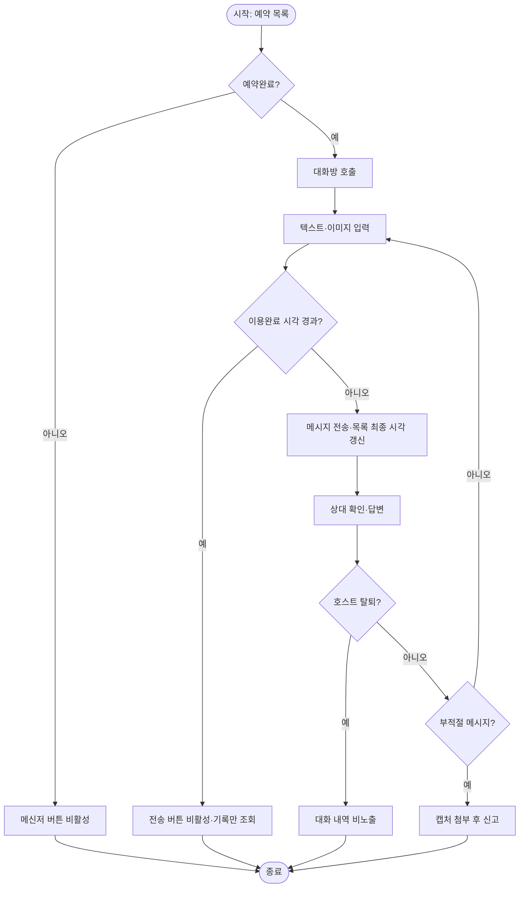

- 대응 프로세스: [P-DOMAIN-MESSAGE-01](processes.md#p-domain-message-01)
- 관련 finding: [V-TERM-MESSENGER-01](validation.md#v-term-messenger-01)
- 추론: 이미지 첨부와 신고를 같은 대화방에서 처리하는 것으로 그렸다. 원문은 "예약내역 화면으로 접속하여 신고"라고 적는다 `[p.18]`.

## F-DOMAIN-CONTENT-01

**공지사항·도움말 운영**

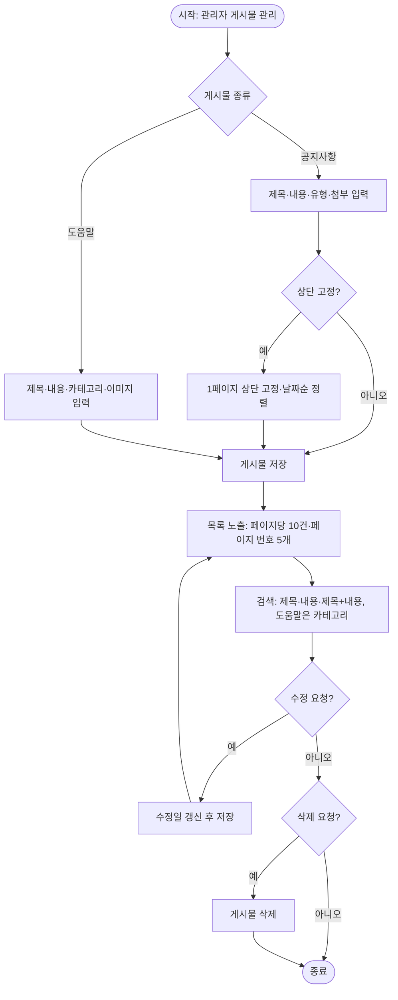

- 대응 프로세스: [P-DOMAIN-CONTENT-01](processes.md#p-domain-content-01)
- 관련 finding: [V-DOMAIN-NOTICE-01](validation.md#v-domain-notice-01), [V-UI-PAGING-01](validation.md#v-ui-paging-01)
- 추론: 두 게시물을 한 플로우에 묶은 것은 편집 편의를 위한 것이며, 프로세스 표에서도 하나로 다룬다.
